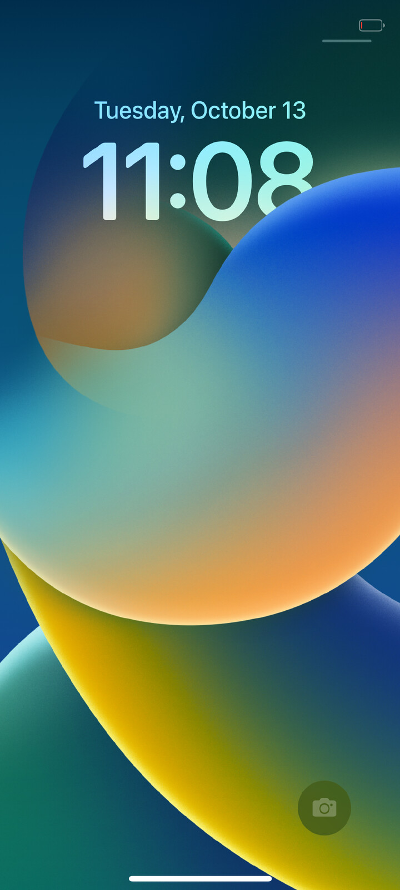
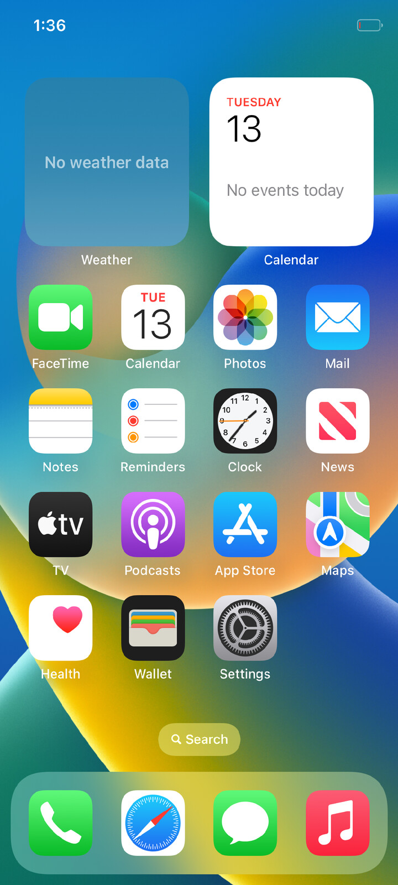
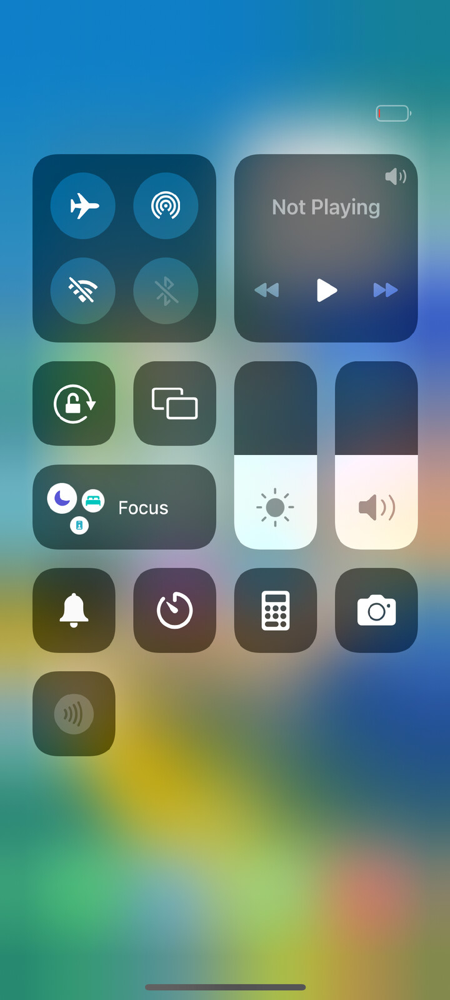
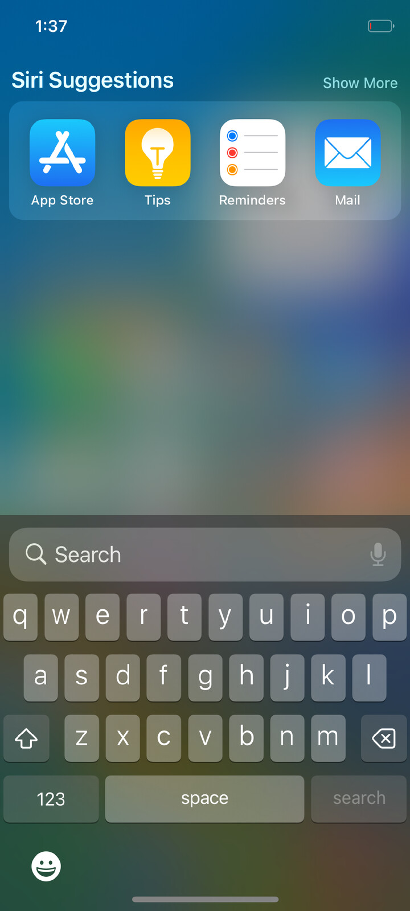
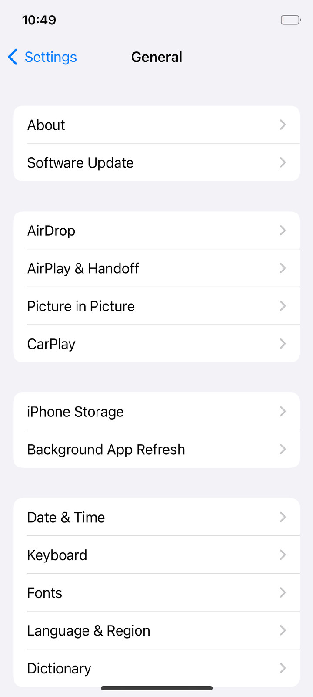
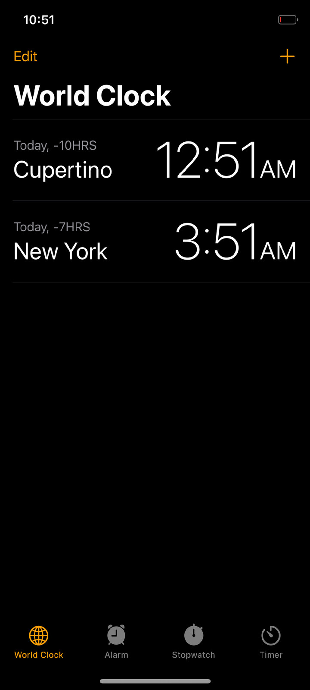
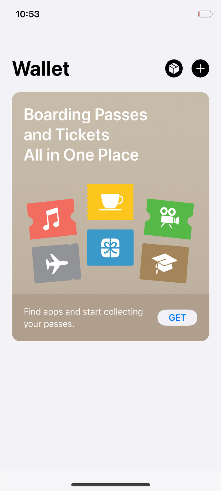
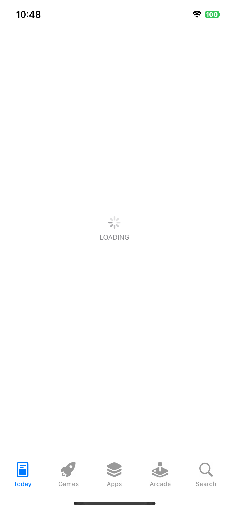

# HackiOS — XNU kernel

**HackiOS** boots Apple's open-source **XNU kernel** (`xnu-8796.121.2`, the kernel of iOS 16.5) on Android phone
hardware and runs the **unmodified iOS 16.5 user space** on top of it: launchd → backboardd → SpringBoard →
apps. Our own EFI loader, our own replacements for Apple's closed drivers, a UEFI port, and a Linux Wi-Fi driver
on a compatibility layer make that possible.

It runs on:

- **OnePlus 8 (instantnoodle, Snapdragon 865)** — the active device. Its iOS volume lives on its own flash; it boots standalone from a menu, or is run from a computer without writing anything;
- **POCO X5 Pro 5G (redwood, Snapdragon 778G)** — where it began: nothing flashed, started with `fastboot boot`, the system lives in RAM, a reboot returns to Android (dual boot optional);
- **QEMU** (`virt`, aarch64) — the same thing on any Linux computer, no phone needed.

This repository is half of the project:

| Repository | What |
|---|---|
| **hackios-xnu-kernel** (this one) | XNU patches, the EFI loader, the UEFI port, Wi-Fi, QEMU scripts, `xl`, prebuilt kernel/loader/UEFI, `common/` scripts, **all documentation** |
| [hackios-xnu-userland](https://github.com/oosexgang/hackios-xnu-userland) | our init, injected libraries, launchd jobs, the APFS image builder, the scripts that take iOS out of Apple's IPSW, Metal/Mesa work |

> **No Apple files are in either repository.** `ios165/fetch.sh` downloads the iOS 16.5 IPSW from Apple's own CDN
> to *your* machine and extracts what is needed there. HackiOS is an independent research project by OOSEX GANG and
> is not affiliated with, authorised or endorsed by Apple Inc. iOS, iPhone and Apple are trademarks of Apple Inc.

<p>




</p>

Photographed on a phone, the Adreno GPU drawing (`gpu=1`). More in [Screenshots](#screenshots).

It is a research bench, not a ROM. **Documentation: [docs/README.md](docs/README.md).** What does not work: [docs/KNOWN_ISSUES.md](docs/KNOWN_ISSUES.md). Roadmap: [docs/TODO.md](docs/TODO.md). Contributors and coding agents: [AGENTS.md](AGENTS.md).

## What works

Per-device detail and evidence: [docs/devices/](docs/devices/README.md). In short, on the **OnePlus 8** (seen working on the phone):

- Boot to SpringBoard, lock screen, home screen, system gestures, Control Center, Settings, Safari and the stock apps; 8 cores, prime core at 2.84 GHz.
- 90 Hz display without tearing; touch screen, power and volume keys, alert slider (ring/silent and Do Not Disturb); battery level and charging.
- Adreno 650 drawing through Mesa/freedreno (OpenGL ES) for CoreAnimation; an experimental Metal driver (off by default, see [gpu.md](docs/subsystems/gpu.md)).
- Wi-Fi (QCA6390): scan, join from Settings (WPA2, WPA2/TKIP, WPA3), DHCP, Safari. Speakers, iOS sounds and the main microphone; haptics; flashlight.
- Display off/on, system sleep and wake (not the SoC's deepest state), GPU powered down in sleep.
- Boots from the phone's flash with a boot menu and rollback guard; iOS's `/private/var` persists on an HFS+ volume.
- Sileo + Procursus (dpkg, apt), tweaks, SSH.

**Does not work yet:** cellular and calls, Bluetooth, cameras (OnePlus 8), sensors (rotation, light, proximity), headphones, fingerprint, location, App Store content and Apple ID sign-in
(no Secure Enclave), fast charging, video recording, Metal for apps. Several power paths (off-mode charging, empty-battery shutdown, wall-charger limit) are built but not yet observed on the phone.
Full list with causes: [docs/KNOWN_ISSUES.md](docs/KNOWN_ISSUES.md).

On the **POCO X5 Pro** (as last documented; not re-verified recently): lock/home screen, touch, 8 cores, GPU, Wi-Fi (WCN6750), sound, cameras with HEIC photos, charging with `adsp=1`, 120 Hz without tearing, dual boot.

## Quick start: QEMU, no kernel build

`prebuilt/` holds the kernel, loader and our programs built from these repositories, so all you need is the system image, which is made on your machine from Apple's IPSW.
Needs Linux x86-64, ~12 GB free disk, 4 GB free RAM, and packages listed in [docs/BUILD.md](docs/BUILD.md) (7-Zip 23+, QEMU, edk2 aarch64).

```sh
git clone https://github.com/oosexgang/hackios-xnu-kernel.git hackios
cd hackios
common/setup.sh               # brings hackios-xnu-userland into the same tree, checks the host
ios165/fetch.sh               # downloads 7.4 GB from Apple's CDN and extracts what is needed (5-15 min)
common/build.sh qemu-virt     # builds the APFS images (and the kernel, if the toolchain is there)
common/run.sh qemu-virt       # a 20-minute session in a QEMU window
```

The lock screen appears after 2-3 minutes. Controls and tips: [docs/devices/qemu.md](docs/devices/qemu.md).

## On a phone

- **OnePlus 8:** [docs/devices/instantnoodle.md](docs/devices/instantnoodle.md) (firmware extraction, `common/run.sh instantnoodle`, `xl`). Always load the profile before `xl enter`.
- **POCO X5 Pro:** [docs/devices/redwood.md](docs/devices/redwood.md). Needs an unlocked bootloader, `adb`, `fastboot`; nothing is written to the phone's storage in a RAM run.
- The phone's **own firmware** (GPU, Wi-Fi, audio DSP, haptics) is not in the repository and cannot be: it is the vendor's and is taken from the very phone it will run on ([docs/BUILD.md](docs/BUILD.md#vendor-firmware-never-in-the-repository)).
- `./xl` with no arguments lists every command (logs, screenshots, screen and sound recording, camera frames, stop, state, install...).

## Install as a boot menu / dual boot

HackiOS can boot from the phone's flash: the UEFI with our loader, the kernel and the boot volume in the `darwin` partition (redwood: next to Android, never written; OnePlus 8: standalone in `boot_b`/`userdata`),
a boot menu at power-on, sessions with no time limit. Two versions are kept, a version that does not come up 3 times is skipped, bundles are SHA-256 checked and, with an owner key pinned, Ed25519-signed.
See [docs/INSTALL.md](docs/INSTALL.md). `common/hackios detect|doctor|install|update|switch|health|test` is the front end; `common/hackios test` runs 14 QEMU scenarios of the boot menu and guard.

## Building from source

`common/build.sh <device>` runs every step the machine can run and uses `prebuilt/` for the rest. Kernel (theos + `iPhoneOS16.5.sdk`, clang), loader (clang + lld-link), images (`userland/build.sh`), UEFI (not needed to run).
Full instructions, traps (`-k`, `export.sh`) and variables: [docs/BUILD.md](docs/BUILD.md); kernel patch layout: [xnu/README.md](xnu/README.md); UEFI: [uefi/README.md](uefi/README.md). After rebuilding: `tools/update-prebuilt.sh`.

## Porting to another device

```sh
common/new-device.sh <codename> path/to/device.dtb   # profile + loader platform from the phone's device tree
```

Then follow [docs/PORTING.md](docs/PORTING.md). Device profiles live in `common/devices/`.

## How it works

```
fastboot boot ──► UEFI (Mu-Silicium) ──► xnuloader (EFI application)
                                           │  stays resident: USB link (fastboot protocol),
                                           │  watchdog, storage, receives the kernel's log
                                           ▼
            XNU (BCM2837 config as the base + our platform)
              ├─ GICv3, timer, PSCI cores, video console, return to the loader
              ├─ APFS (images in RAM, iOS volume on flash), ramfs / HFS+ for /private/var
              ├─ minicrypto instead of corecrypto, AMFI and Sandbox stand-ins (MAC policies)
              ├─ driver replacements: IOSurface, IOMobileFramebuffer, AppleKeyStore, backlight, network stack
              ├─ input: /dev/hk-touch ◄─ touch chip (Goodix / Samsung) or virtio-input (QEMU)
              ├─ GPU: Adreno 642L / 650, Wi-Fi: ath11k via a Linux compatibility layer, sound: audio DSP / virtio-sound
              ▼
   iOS 16.5 launchd → logd, notifyd, cfprefsd, runningboardd, backboardd, SpringBoard, apps
              ├─ our libraries are injected into backboardd, SpringBoard and mediaserverd
              │  (virtual HID services, ObjC method swaps — in memory only)
              └─ mediaserverd gets our CoreAudio output device (HKAudio.driver)
```

The iOS programs, frameworks and dyld shared cache are not changed by a single byte: what they miss is done by the kernel (driver replacements) or by a library the kernel injects with `DYLD_INSERT_LIBRARIES`
(`kern.exec_inject`). Full architecture: [docs/architecture.md](docs/architecture.md).

## Layout

| Path | What |
|---|---|
| `AGENTS.md`, `CLAUDE.md` | rules for coding agents (CLAUDE.md just imports AGENTS.md) |
| `docs/` | documentation ([index](docs/README.md)), screenshots in `docs/images/` |
| `common/` | `setup.sh` (workspace), `build.sh` / `run.sh` (per device), `new-device.sh`, `hackios` (CLI), `devices/*.conf`, `flash/` (installer), `ugit` |
| `xl` | drives the phone over USB: loader, kernel runs, logs, screenshots, screen and sound recording |
| `xnuloader/` | the loader: `loader.c`, `flashboot.c` (menu, bundles, guard), `crypto.c`, `mkpayload.py` |
| `xnu/` | our XNU changes: patch, new files, `apply.sh` / `export.sh` |
| `xnu-deps/`, `xnu-build.sh`, `xnu-env.sh` | everything for building XNU on Linux |
| `uefi/`, `mkxnuimg.py` | the UEFI port and packing the boot image for `fastboot boot` |
| `wifi/lx/` | the layer on which Linux's Wi-Fi driver builds for our kernel |
| `qemu/` | QEMU runs, touch input, screenshots, stack symbolication |
| `tools/` | `t` (OnePlus tests), recording, UFS/flash tools, `mk-ath11k.sh`, host tests (`mhi-test/`, `wpa-test/`, `qmi-test/`, `thermal-test/`, `sleep-test/`, `crypto-test/`) |
| `prebuilt/` | built kernel, loader and UEFI pieces (`NOTICES.md` lists the third-party code in the kernel) |
| `userland/`, `ios165/` | the userland repository's files in the same tree (`common/ugit`) |

## Debugging

- Session log: QEMU's stdout or `logs/HHMMSS-run.log` from the phone.
- `RC_JOBS=rc.jobs.tour REST=1 userland/build.sh` — an image that unlocks and opens every app of the first page.
- `userabort:` in the log is the stack of a process that called `abort()`; `usertrap:` (with `systrace=1`) — crashes.
- Live stacks (QEMU): `qemu/touch.py stacks NAME`, then `qemu/symstack.py LOG NAME` (needs [`ipsw`](https://github.com/blacktop/ipsw)).
- How a check can lie to you: [docs/research/checks.md](docs/research/checks.md). Tests: [docs/TESTING.md](docs/TESTING.md). Boot arguments: [docs/BOOT_ARGS.md](docs/BOOT_ARGS.md).

## Screenshots

From a phone's screen, one session (`GL=1 REST=1`, `gpu=1`):

<p>


 General">


</p>
<p>




</p>

(The App Store shot is the tab bar only: its content does not load, see [KNOWN_ISSUES K11](docs/KNOWN_ISSUES.md#k11-app-store-apple-id-icloud-push-fairplay--all--unsupported-blocked--s2).)
Other images in `docs/images/` (health, news, reminders, GPU first frame, ...) are kept as project history.

## Licenses

- No iOS files are in the repositories: `ios165/fetch.sh` downloads them from Apple's CDN to your machine.
- `xnu/` is a derivative work of XNU and is distributed under APSL 2.0, like XNU itself; `prebuilt/mach.*` is the
  kernel built from it. It also contains ath11k (BSD-3-Clause-Clear) and FreeBSD LinuxKPI code (BSD-2-Clause):
  see [prebuilt/NOTICES.md](prebuilt/NOTICES.md). Apple's HFS+ (APSL 2.0) is fetched at build time by `xnu/hfs-stage.sh`.
- `xnu/files/bsd/miscfs/apfs/libzbitmap/` and `xnu-deps/build/lzbitmap/` — libzbitmap (Corellium LLC, MIT here);
  `xnu/files/bsd/miscfs/apfs/libdeflate/` — libdeflate 1.24 (Eric Biggers, MIT, `COPYING` there).
- ath11k, Linux and FreeBSD sources are not in the repository: `tools/mk-ath11k.sh` fetches pinned releases.
  The MHI host (`wifi/lx/src/mhi_host.c`) is ours, written from the MHI register and ring layout as OpenBSD's
  qwx(4) (ISC, Stefan Sperling) and Linux describe it; no code of Linux's GPL MHI host is in it.
  `wifi/lx/patches/*.patch` are our changes to FreeBSD headers; the rest of `wifi/lx/` is ours.
- `uefi/files/Binaries/redwood`, `uefi/files/Binaries/instantnoodle` and `prebuilt/uefi/SILICIUM_UEFI.fd` contain UEFI drivers from the phones'
  vendor firmware, distributed the way Project Silicium distributes them for other devices;
  `prebuilt/uefi/mkbootimg.py` — AOSP, Apache-2.0.
- This repository is licensed under the [Apple Public Source License 2.0](LICENSE): our changes to XNU are a derivative of XNU and must be, and our other code here (loader, scripts) is released under the same license. Third-party code keeps its own license, as listed above.

## Team

OOSEX GANG — [@oodze](https://t.me/oodze) (founder), [@netusd](https://t.me/netusd), [@wannqn](https://t.me/wannqn),
[@hxfuxyyXD](https://t.me/hxfuxyyXD). News: [t.me/oosexgangdevs](https://t.me/oosexgangdevs).
